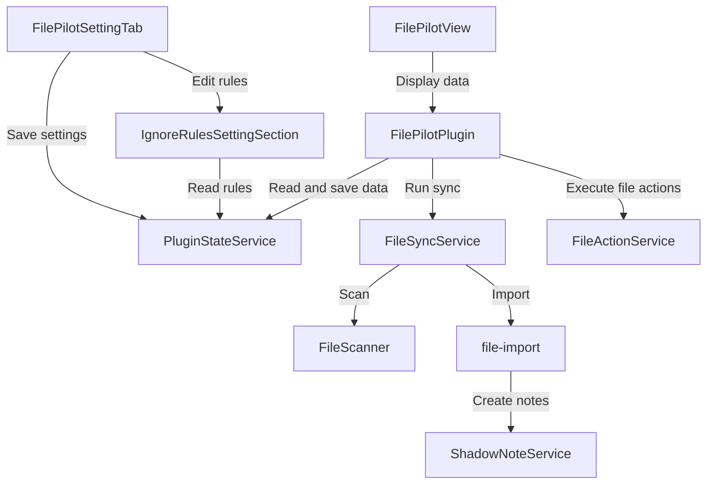
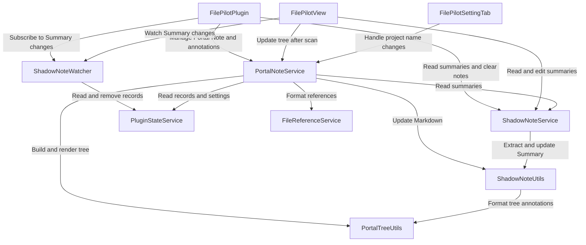
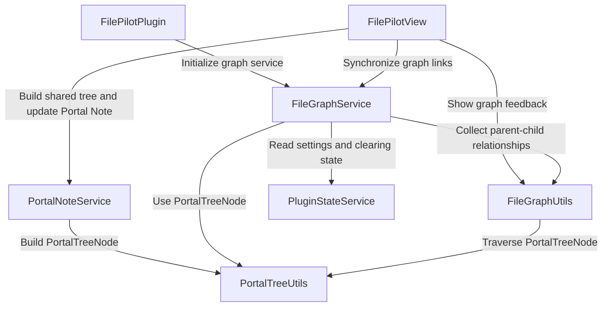
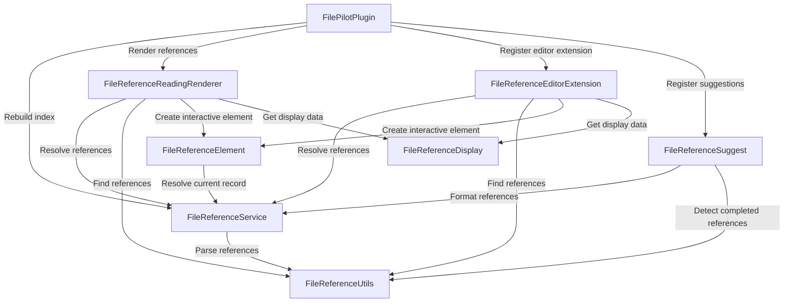

# File Pilot — C3 Component Diagram

The following views show direct component dependencies within the same plugin.

## File Management and Settings

## Shadow Notes and Portal Note

## File Graph

## File References

